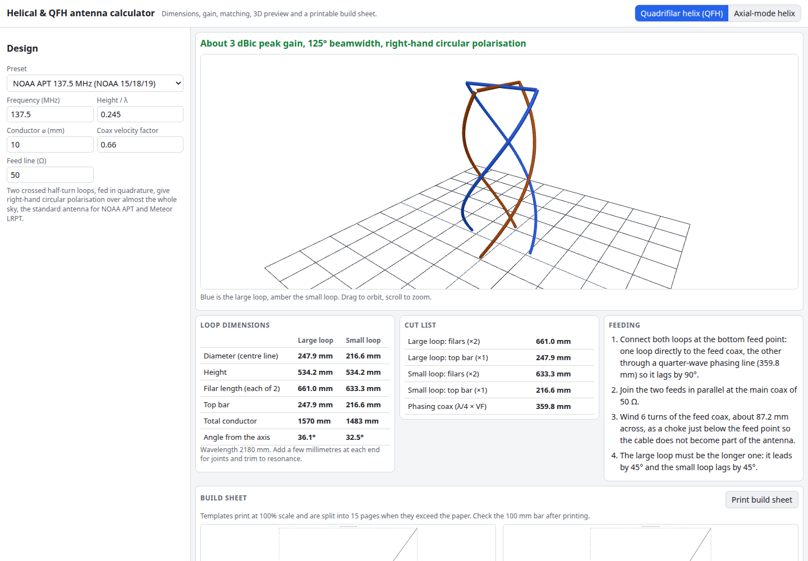

# Helical & QFH Antenna Calculator

Design an axial-mode helical antenna (Kraus) or a quadrifilar helix (QFH) for 137 MHz weather satellites, L-band and beyond. Get the dimensions, gain, beamwidth, feed impedance and a matching section, spin the result in 3D and print a build sheet with full-size templates. Everything runs in your browser.

**Try it: [hermes98761234.github.io/helical-qfh-calculator](https://hermes98761234.github.io/helical-qfh-calculator/)**

[](https://github.com/hermes98761234/helical-qfh-calculator/actions/workflows/deploy.yml)



## Features

- **Axial-mode helix (Kraus).** Frequency, C/λ, pitch angle, turns, conductor and ground plane give diameter, turn spacing, wire length, directivity, half-power and null-to-null beamwidth, axial ratio and feed resistance, with warnings outside the axial-mode window. A gain-versus-turns chart and an inverse "turns for this gain" button are included.
- **Matching section.** Quarter-wave transformer impedance for your feed line, as a microstrip (width and length on your substrate, Hammerstad-Jensen) or as an air coax (D/d and length).
- **Quadrifilar helix (QFH).** Large and small half-turn loops solved from the loop length, with diameters, filar and top-bar lengths, a cut list, the quarter-wave phasing coax for your velocity factor, a feed-coax choke and wiring steps.
- **Presets.** NOAA APT 137.5 MHz, NOAA 19, Meteor-M LRPT, Iridium, GPS L1 and Inmarsat for the QFH; 70 cm, Wi-Fi, 5.8 GHz FPV, GOES HRIT and 2 m for the helix.
- **3D preview** with Three.js: orbit and zoom around the real geometry.
- **Printable build sheet.** Wrap templates and a ground-plane disc at 1:1 scale, tiled onto A4 or Letter pages with a 100 mm check bar.
- **English and Ukrainian**, light, dark or system theme, millimetres or inches. Settings and your design are kept in the browser. There is no backend and no tracking.

## How it works

The helix uses the textbook relations from Kraus, *Antennas*: directivity `D = 15 N (C/λ)² (S/λ)`, half-power beamwidth `52 / ((C/λ) √(N S/λ))`, first-null beamwidth `115 / ((C/λ) √(N S/λ))`, input resistance `≈ 140 C/λ` and axial ratio `(2N+1)/2N`. The pitch angle sets the spacing through `tan α = S/C`.

The QFH is two crossed, bifilar half-turn loops. The longer loop leads by 45° and the shorter lags by 45°, which makes right-hand circular polarisation with a wide cardioid pattern. Each loop is a pair of helical filars of length `√(H² + (πD/2)²)` joined by a top bar of length `D`. The calculator solves the diameter that gives the loop conductor length of about 0.725 λ (large) and 0.685 λ (small) at your chosen height, with a small shortening for thick conductors. The loop proportions follow the commonly built 137 MHz designs, so treat them as a starting point and trim on an analyser. The QFH gain and beamwidth shown (about 3 dBic and 125°) are typical values, not a simulation.

## Quick start

You need [Node.js](https://nodejs.org/) 22.

```bash
git clone https://github.com/hermes98761234/helical-qfh-calculator.git
cd helical-qfh-calculator
npm install
npm run dev       # http://localhost:5173
npm test          # formula, geometry, template and i18n tests
npm run build     # static site in dist/
```

## License

MIT
